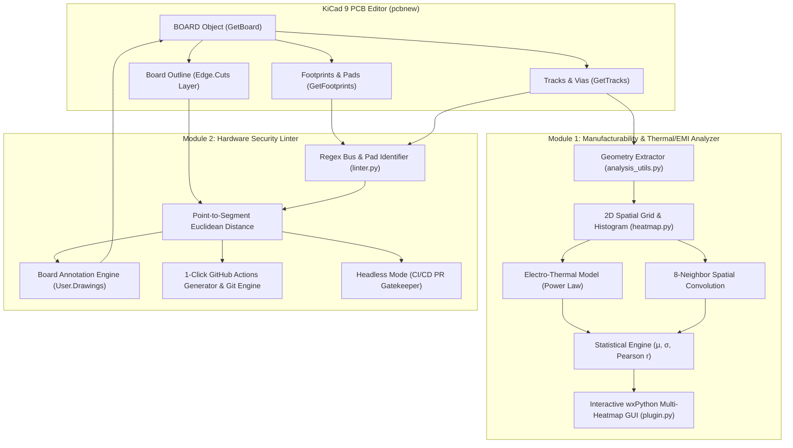
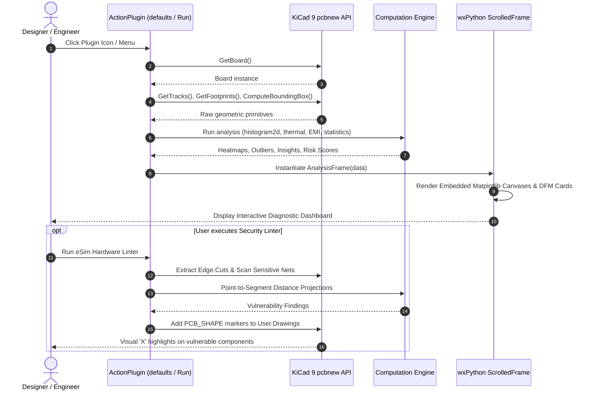

# Design Document: eSim KiCad Plugin Suite
## Smart PCB Manufacturability, Thermal & EMI Risk Analyzer & Hardware Security Linter

**Task 6: KiCad Plugin Development (CSE & Related Fields)**  
**eSim Semester Long Internship - Autumn 2026**  
**Author:** Dhyey Kabra  
**Target Environment:** KiCad 9.0+ / eSim EDA Ecosystem (Python 3.10+ / wxPython / NumPy / Matplotlib)

---

## 1. Executive Summary & Problem Formulation

In modern electronic product design, transitioning from schematic capture (in **FOSSEE eSim**) to physical printed circuit board (PCB) layout (in **KiCad `pcbnew`**) is a complex, error-prone phase. Designers—especially students and junior engineers—often focus exclusively on geometric connectivity (Design Rule Check / DRC: "does trace A touch trace B?") while remaining blind to critical physical, electro-thermal, manufacturing, and security risks:

1. **Joule Heating & Thermal Hotspots ($I^2R$):** Clustered, thin traces carrying current generate excessive heat that cannot dissipate efficiently, reducing component lifespan and risking board delamination.
2. **Electromagnetic Interference (EMI) & Parasitic Coupling:** Dense, parallel signal routing causes high mutual inductance and capacitive crosstalk, degrading signal integrity.
3. **Design for Manufacturability (DFM) Bottlenecks:** Sub-optimal trace widths, extreme trace width variances, and high via density drastically reduce manufacturing yield and increase PCB fabrication failure rates.
4. **Physical Hardware Attack Surface:** Placement of sensitive debug buses (UART, JTAG, SWD, SPI flash) along the outer perimeter of the PCB exposes the device to physical eavesdropping, firmware dumping, and Electromagnetic Fault Injection (EMFI).

### The Solution
The **eSim KiCad Plugin Suite** bridges Computer Science algorithms with physical Electronics principles directly inside KiCad 9:
- **Module 1: Smart PCB Manufacturability Risk Analyzer (`pcb_manufacturability_risk_analyzer`)** converts the board geometry into a continuous 2D spatial density matrix, computes electro-thermal and EMI risk distributions, and presents interactive multi-heatmap visual feedback and DFM metrics.
- **Module 2: eSim Hardware Security Linter (`esim_hw_linter`)** runs computational geometry algorithms (point-to-segment distance projections) to enforce perimeter physical security clearances for sensitive debug interfaces, with 1-click CI/CD GitHub Actions automation.

---

## 2. Theoretical Integration: Computer Science & Electronics

The plugin suite is intentionally designed at the intersection of Computer Science and Electronics:

| Domain | Theoretical Concept | Implementation in Plugin Suite |
| :--- | :--- | :--- |
| **Computer Science** | **2D Spatial Discretization & Binning** | Converts arbitrary trace line segments into discrete grid bins via 2D spatial histograms (`np.histogram2d`), achieving $O(N)$ spatial mapping. |
| **Computer Science** | **Numerical Matrix & Statistical Analysis** | Computes trace width distributions ($\mu, \sigma, \min$), Pearson correlation coefficient ($r$), and multi-variable weighted risk scores. |
| **Computer Science** | **Computational Geometry** | Implements minimum Euclidean distance projection from points (footprints/pads) to edge segments (Edge.Cuts) with boundary clamping ($t \in [0, 1]$). |
| **Computer Science** | **Lexical Pattern Matching (Regex/AST)** | Dynamic regex matching with word boundaries (`\b`) to identify sensitive buses (`TX`, `RX`, `SWDIO`, `JTAG`) without false positives. |
| **Computer Science** | **Asynchronous UI & Embedded Canvas** | Non-blocking wxPython scrolled dialog hosting live Matplotlib `FigureCanvasWxAgg` graphics. |
| **Computer Science** | **CI/CD DevSecOps Automation** | Automated GitHub Actions `.yml` generation, Git plumbing automation, and headless CLI mode (`xvfb-run`) with exit codes. |
| **Electronics** | **Joule Heating & Power Dissipation** | Approximates thermal rise using Ohm's Law and Joule heating: $P = I^2 R$, where $R \propto \frac{1}{\text{Width}}$. Normalized density represents current concentration. |
| **Electronics** | **EMI & Parasitic Coupling** | Evaluates spatial 8-neighborhood kernel convolution to model capacitive/inductive mutual coupling between adjacent high-speed traces. |
| **Electronics** | **Design for Manufacturability (DFM)** | Audits minimum etching limits (< 0.15 mm), copper balancing, via density stress, and etching acid traps. |
| **Electronics** | **Hardware Threat Modeling & EMFI** | Identifies physical attack vectors against IoT hardware perimeters (IPC-2221 edge clearances and Fault Injection vulnerability). |

---

## 3. High-Level System Architecture



---

## 4. Detailed Component & Module Breakdown

### 4.1 Module 1: `pcb_manufacturability_risk_analyzer`

#### 1. Data Ingestion & Conversion (`analysis_utils.py`)
- **KiCad API Binding:** Queries `board.GetTracks()`, extracting start/end coordinates and track widths in internal units (IU, where $1\text{ mm} = 10^6\text{ nm}$).
- **Conversion Utility:**
  $$\text{Width}_{\text{mm}} = \frac{\text{Width}_{\text{IU}}}{10^6}$$
- **Statistical Aggregation:** Computes mean track width ($\mu$), minimum track width ($\min$), and standard deviation ($\sigma$).

#### 2. Spatial Grid Discretization (`heatmap.py`)
- Evaluates the board bounding box (`board.ComputeBoundingBox()`).
- Partitions the board into a $20 \times 20$ Cartesian grid.
- Accumulates track endpoint coordinates into a 2D spatial frequency matrix:
  $$H[i, j] = \sum \mathbf{1}_{(x, y) \in \text{Cell}(i, j)}$$

#### 3. Electro-Thermal Model
- Current concentration is approximated by normalized spatial trace density:
  $$D_{\text{norm}}[i, j] = \frac{H[i, j]}{\max(H)}$$
- Power dissipation is modeled via Joule heating:
  $$\text{ThermalScore}[i, j] = \min\left((D_{\text{norm}}[i, j])^2 \times \frac{1}{\bar{w} + \epsilon}, 100\right)$$
- Ambient temperature simulation:
  $$T[i, j] = T_{\text{ambient}} + (\text{ThermalScore}[i, j] \times S)$$
  *(where $T_{\text{ambient}} = 25^\circ\text{C}$ and scale factor $S = 20$)*.

#### 4. EMI Risk Neighbor Coupling
- Models parasitic fringing fields by convolving each cell with its 8 nearest spatial neighbors:
  $$\text{Coupling}[i, j] = \frac{1}{|\mathcal{N}|} \sum_{(ni, nj) \in \mathcal{N}} H[ni, nj]$$
  $$\text{EMIScore}[i, j] = \frac{H[i, j]}{\max(H)} + \frac{\text{Coupling}[i, j]}{\max(H)}$$

#### 5. Interactive UI & Embedded Visualizations (`plugin.py`)
- Built on `wx.lib.scrolledpanel.ScrolledPanel` to provide a responsive, scrollable dashboard.
- Hosts 4 synchronized Matplotlib subplots (`FigureCanvasWxAgg`):
  1. **Density Heatmap:** Colormap `viridis`, displaying copper density.
  2. **Thermal Heatmap:** Colormap `inferno`, showing thermal intensity.
  3. **EMI Risk Map:** Colormap `coolwarm`, indicating cross-talk hotspots.
  4. **Temperature Map:** Colormap `hot`, displaying simulated degrees Celsius.
- Automatically draws red bounding boxes around critical hotspot zones ($\ge 60\%$ peak density).
- Includes track width distribution histogram and Pearson correlation scatter plot.

---

### 4.2 Module 2: `esim_hw_linter`

#### 1. Lexical Pattern Matching
- Scans `board.GetFootprints()` and pad netlists against security-sensitive bus tokens:
  ```python
  target_strings = ["UART", "JTAG", "DEBUG", "CONSOLE", "PROG", "ISP", "ICSP", "24C", "W25Q", "SPI", "TEST"]
  sensitive_nets = ["TX", "RX", "TXD", "RXD", "SWDIO", "SWCLK", "MISO", "MOSI", "TCK", "TMS", "TDI", "TDO", "SDA", "SCL", "BOOT"]
  ```
- Uses regex word boundary checks (`\b`) to prevent false positives (e.g. matching `TX` inside `MATRIX`).

#### 2. Computational Geometry Engine
- Extracts all perimeter segments from the `Edge.Cuts` layer.
- For each target component position $\mathbf{P}$ and edge segment defined by endpoints $\mathbf{A}$ and $\mathbf{B}$:
  $$\mathbf{V} = \mathbf{B} - \mathbf{A}, \quad l^2 = \|\mathbf{V}\|^2$$
  $$t = \max\left(0, \min\left(1, \frac{(\mathbf{P} - \mathbf{A}) \cdot \mathbf{V}}{l^2}\right)\right)$$
  $$\mathbf{P}_{\text{proj}} = \mathbf{A} + t \mathbf{V}, \quad d = \|\mathbf{P} - \mathbf{P}_{\text{proj}}\|$$
- Compares minimum distance $d_{\min}$ against user-defined thresholds:
  - $d_{\min} < \text{Threshold}_{\text{crit}}$ (default 5.0 mm): **CRITICAL RISK**
  - $d_{\min} < \text{Threshold}_{\text{warn}}$ (default 15.0 mm): **WARNING**

#### 3. Visual Board Annotations
- For any vulnerable footprint or EMFI trace, the plugin dynamically constructs `pcbnew.PCB_SHAPE` cross markers ($2\text{ mm} \times 2\text{ mm}$ red 'X') directly onto the `User.Drawings` layer, providing instant visual feedback on the layout canvas.

#### 4. DevSecOps CI/CD Automation
- Generates a GitHub Actions workflow `.github/workflows/security.yml`.
- Automatically stages and commits the board and workflow file using Git subprocess plumbing.
- Supports headless execution via `xvfb-run` inside standard Docker containers (`kicad/kicad:9.0`), halting PR merges with exit code 1 if physical security rules are violated.

---

## 5. Component Interaction & Data Flow Diagram



---

## 6. KiCad 9 API Compatibility Considerations

KiCad 8 and 9 introduced significant modernizations to the Python scripting API:
1. **Coordinate Geometry:** Coordinates are strictly represented as `pcbnew.VECTOR2I` (integer nanometers). All floating-point millimeters must be converted using `pcbnew.FromMM()` and `pcbnew.ToMM()`.
2. **Drawing Primitives:** Legacy `DRAWSEGMENT` was superseded by `pcbnew.PCB_SHAPE`, with shape constants `pcbnew.SHAPE_T_SEGMENT`.
3. **Net Inspection:** Net names on tracks and pads are accessed safely via `track.GetNetname()` or `track.GetNet().GetNetname()`.
4. **Layer Identification:** Layer IDs are resolved dynamically using `board.GetLayerID("Edge.Cuts")` and `board.GetLayerID("User.Drawings")` rather than fragile hardcoded integers.

Both plugins in this suite strictly adhere to these modern KiCad 9 API standards.

---

## 7. Error Handling, Edge Cases & Robustness

- **Unrouted Boards:** If a board contains zero copper tracks, the plugin intercepts the condition gracefully, alerting the user with `wx.MessageBox` rather than crashing with zero-division errors.
- **Missing Board Outline:** If no `Edge.Cuts` boundary is present, the linter warns the user to draw an outline before performing spatial distance measurements.
- **Zero Variance Sets:** When all traces have identical widths, standard deviation is zero; the correlation calculation protects against division by zero by clamping $r = 0$.
- **Non-blocking UI:** Heavy drawing tasks and file saves are separated from the main thread, and browser-opening routines use non-blocking `wx.CallLater` timers.

---

## 8. Future Roadmap for Internship Period

This working prototype lays a robust foundation that can be extended during the semester-long internship:
1. **Finite Element Method (FEM) Thermal Simulation:** Integrate a true 2D Poisson thermal diffusion solver for exact steady-state heat flux.
2. **Impedance Calculation & Differential Pair Matching:** Add microstrip and stripline characteristic impedance ($Z_0$) auditing for high-speed differential pairs (USB, PCIe, Ethernet).
3. **eSim Schematic Back-Annotation:** Bi-directionally communicate layout risk scores back into the eSim schematic editor to highlight problematic nets at the circuit simulation stage.
